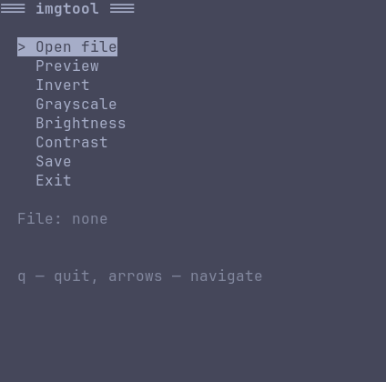

# imgtool

Terminal image editor. Curses-based TUI with live preview via Kitty graphics protocol.



## Features

- Open, edit, save images without leaving the terminal
- Operations: invert, grayscale, brightness, contrast
- Preview via Kitty graphics protocol (kitty, ghostty, wezterm, konsole)
- ASCII fallback preview for other terminals
- Prompt to save on exit if modified

## Requirements

- Python 3.10+
- Linux / macOS
- A terminal that supports either:
  - **Kitty graphics protocol** — kitty, ghostty, wezterm, konsole (full preview)
  - **ANSI true color** — any modern terminal (ASCII preview)

## Install

### pipx (recommended)

```bash
pipx install git+https://github.com/dkuznetsov700-ui/imgtool
```

### From source

```bash
git clone https://github.com/dkuznetsov700-ui/imgtool
cd imgtool
python -m venv .venv
source .venv/bin/activate
pip install -e .
```

## Usage

```bash
imgtool
```

Navigate with arrows, Enter to select, `q` to quit.

## Terminal support

| Terminal | Preview |
|----------|---------|
| kitty | full (Kitty protocol) |
| ghostty | full (Kitty protocol) |
| wezterm | full (Kitty protocol) |
| konsole | full (Kitty protocol) |
| alacritty | ASCII fallback |
| gnome-terminal | ASCII fallback |
| xterm | ASCII fallback |
| tmux | ASCII fallback (unless `allow-passthrough on`) |

The menu works in any terminal. Only the preview depends on protocol support.

## Uninstall

```bash
pipx uninstall imgtool
```

## License

MIT — see [LICENSE](LICENSE).
